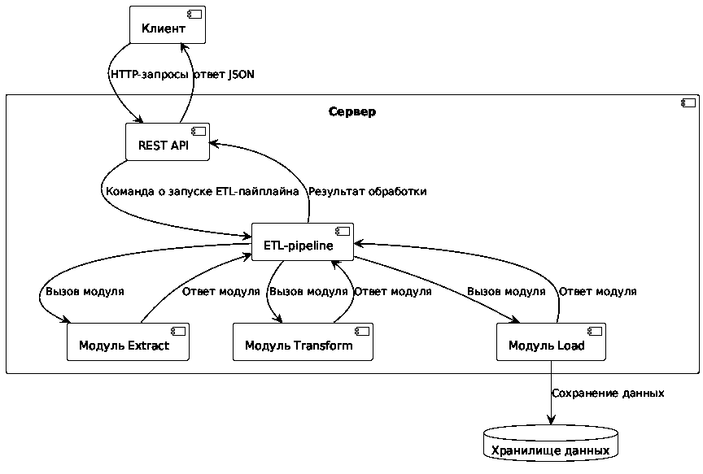

# Генерация PDF из статьи об ETL-системе

**Семестровый проект по дисциплине «Документирование и управление версиями программного обеспечения».**

Тема статьи: **«ETL–СИСТЕМА ДЛЯ КОНСОЛИДАЦИИ ДАННЫХ С ДИНАМИЧЕСКИМ ВЫБОРОМ АЛГОРИТМА ОБРАБОТКИ»**.
Автор: Часовских А. А.; научный руководитель: Лобанов А. А. (2025).
Публикация: [eLIBRARY, ID 82352919](https://www.elibrary.ru/item.asp?id=82352919).

## Что делает проект

Исходники статьи хранятся в **нескольких Markdown-файлах** (`docs/`).
Команда `make pdf` преобразует их в **один PDF** через Pandoc и XeLaTeX.
В репозитории есть оригинальная иллюстрация из статьи, таблица, список литературы,
содержание и математическая формула LaTeX.

**Принцип:** номера не написаны вручную. В Markdown у рисунка и таблицы
есть постоянные идентификаторы (`fig:architecture`, `tbl:storage`),
а подписи, значения номеров и ссылки формирует LaTeX при сборке.

## Состав проекта

```text
etl-article-docs/
├── .github/workflows/build.yml  # GitHub Actions: сборка на push/PR/вручную
├── .gitignore                    # исключает build/ из Git
├── Makefile                      # команды make pdf, make check, make clean
├── README.md                     # инструкция
├── assets/
│   └── etl-architecture.png     # исходный рисунок из статьи
├── docs/
│   ├── 00-frontmatter.md        # авторы, две аннотации, оглавление
│   ├── 01-introduction.md       # введение
│   ├── 02-architecture.md       # рисунок, таблица и ссылки
│   ├── 03-transformer.md        # модуль Transformer
│   ├── 04-algorithm.md          # алгоритм и методы
│   ├── 05-conclusion.md         # заключение
│   ├── 06-references.md         # список литературы
│   └── 07-formula-appendix.md   # отдельно отмеченное УЧЕБНОЕ приложение
├── filters/
│   └── table_labels.lua         # передаёт ID таблицы в LaTeX
├── scripts/
│   └── check_pdf.py             # проверяет сформированный PDF
└── tex/
    └── preamble.tex             # шрифты и оформление подписей
```

## Сборка на Ubuntu (включая локальную Ubuntu-консоль)

Требуются `make`, `pandoc`, `xelatex`, шрифты DejaVu и `pdftotext`.

```bash
sudo apt-get update
sudo apt-get install -y make pandoc texlive-xetex texlive-lang-cyrillic \
  texlive-latex-extra texlive-fonts-recommended fonts-dejavu-core poppler-utils

make pdf        # создать build/article.pdf
make check      # создать PDF и проверить основные элементы
make clean      # удалить только сгенерированные файлы
make rebuild    # пересобрать заново
```

Откройте `build/article.pdf` в программе просмотра PDF. Не нужно вручную
открывать/сохранять исходник Word: преобразование выполняется из Markdown.

## Автоматическая сборка на GitHub

Файл `.github/workflows/build.yml` — сценарий **GitHub Actions**.
Он запускается при `push`, `pull_request` и через кнопку **Run workflow**.
Сценарий получает исходники (`checkout`), устанавливает Pandoc и TeX,
выполняет `make check`, затем сохраняет PDF как **Artifact**.

Где скачать результат: репозиторий → **Actions** → нужный запуск
→ **Artifacts** → `etl-article-pdf`. PDF хранится в скачиваемом архиве GitHub;
это результат сборки, а не файл, который нужно вручную загружать в репозиторий.

## Как работает автонумерация

Рисунок в `docs/02-architecture.md`:

```markdown
... (рисунок \ref{fig:architecture}).

{#fig:architecture width=80%}
```

Обратите внимание: **в подписи нет «Рисунок 1»**. Из `{#ID}`
Pandoc генерирует LaTeX `\caption{...}\label{fig:architecture}`.
LaTeX выводит «Рисунок 1» и подставляет его номер в `\ref{fig:architecture}`.

Таблица в `docs/02-architecture.md` записана **настоящей Markdown-таблицей**
в блоке `::: {#tbl:storage}`. Небольшой Lua-фильтр `filters/table_labels.lua`
передаёт идентификатор `tbl:storage` таблице Pandoc. В PDF это становится
`\caption{Хранение данных в системе}\label{tbl:storage}`.
Ссылка в тексте оформлена как `\ref{tbl:storage}` и также обновляется автоматически.

Содержание вставлено командой `\tableofcontents` в `docs/00-frontmatter.md`;
его заголовки и номера страниц также пересчитываются при сборке.
- `docs/02-architecture.md` + `filters/table_labels.lua` — рисунок,
  Markdown-таблица, идентификаторы и ссылки через `\ref`.
- `docs/00-frontmatter.md` — динамическое оглавление.
- `docs/07-formula-appendix.md` — математическая формула LaTeX.
- `make rebuild` → `make check` и готовый `build/article.pdf`.
